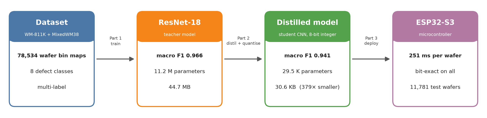
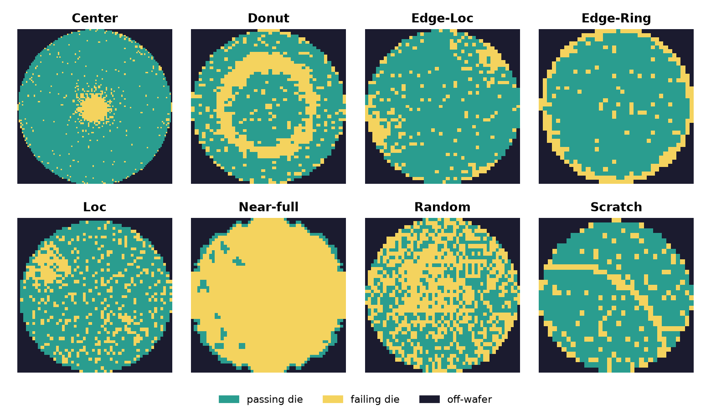
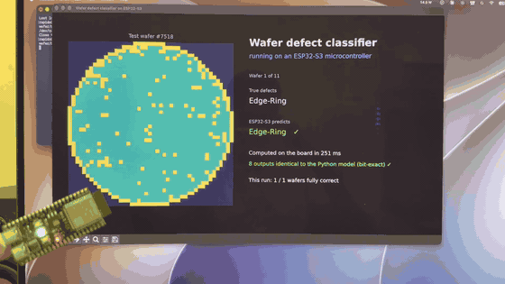

# Semiconductor Wafer Defect Classifier

Deep learning model that recognises defect patterns in semiconductor wafer bin maps. I first trained a ResNet-18
classifier (macro F1 0.966). I then distilled it into a 30 KB integer-only network (macro F1 0.941) that runs on a
~$5 ESP32-S3 microcontroller.

| | Part 1: ResNet-18 | Part 2: distilled model | Part 3: on the ESP32-S3 |
|---|---:|---:|---:|
| Test macro F1 | 0.966 | 0.941 | 0.941 (measured on the board) |
| Size | 44.7 MB | 30.6 KB | 30.6 KB |
| Runs on | GPU / laptop | anything | a microcontroller, 251 ms per wafer |

---

## Part 1: Classifying wafer defects with ResNet-18

### The problem
After fabrication, every die on a silicon wafer is electrically tested. A **wafer bin map (WBM)** records which
dies pass and which fail. The spatial pattern of the failures gives us the cause: a ring at the edge, a scratch,
a cluster at the centre. Each pattern is a result of a different equipment or process fault. Checking these
maps by eye is not feasible in a modern fab, so the task is to classify them automatically.

The model recognises **8 defect patterns**: Center, Donut, Edge-Loc, Edge-Ring, Loc, Near-full, Random and Scratch.
A wafer can have **several defects at once**, so this is a **multi-label** problem, and the model can recognise then. 
Each class gets its own sigmoid output instead of one softmax over all classes.

*One test-set wafer for each defect class. Yellow dies failed the electrical test.*

### Data
- **Sources:** two public datasets, **WM-811K** (single-pattern labels) and **MixedWM38** (multi-pattern labels),
  combined into **78,534 wafers**.
- **Contents:** all WM-811K wafers with one of the 8 defect labels, 15,000 randomly sampled defect-free WM-811K
  wafers, and the MixedWM38 wafers.
- **Split:** 70% train / 15% validation / 15% test (54,973 / 11,780 / 11,781 wafers), fixed random seed. The
  test set is used only for final scores.
- **Hardest classes:** Scratch (2,059 labels in total) and Near-full (298) are rare compared with the other
  classes. These are the hardest to learn.

### Preprocessing
- Every map is resized to 224x224 
- The map is copied into 3 channels and normalised with ImageNet statistics, to match the ResNet-18 input.
- Training augmentation: random horizontal and vertical flips, and rotations up to ±90°. A wafer's defect
  pattern does not depend on its orientation.

### Models and training
- **ResNet-18:** initialised from ImageNet pre-trained weights, with its final layer replaced by 8 outputs.
- **Vanilla CNN:** a small 3-layer baseline (16-32-32 filters, 3x3 convolutions, max pooling, two dense layers),
  trained from scratch.
- **Training (both models):**
  - binary cross-entropy loss, Adam (learning rate 1e-4, weight decay 1e-5), batch size 256, 20 epochs;
  - the checkpoint with the lowest validation loss is kept;
  - a defect counts as present when its sigmoid output is above 0.5.
  The training script also supports focal loss as an alternative to binary cross-entropy.

### Results  (Test set, 11,781 wafers)

| Model | Macro F1 | Micro F1 | Parameters |
|---|---:|---:|---:|
| **ResNet-18** | **0.966** | **0.980** | 11.2 M | 
| Vanilla CNN | 0.857 | 0.908 | 3.2 M | 

| Class | ResNet-18 F1 | Vanilla CNN F1 |
|---|---:|---:|
| Center | 0.985 | 0.964 |
| Donut | 0.997 | 0.973 |
| Edge-Loc | 0.959 | 0.892 |
| Edge-Ring | 0.988 | 0.964 |
| Loc | 0.972 | 0.904 |
| Near-full | 0.911 | 0.846 |
| Random | 0.989 | 0.818 |
| Scratch | 0.925 | 0.499 |

The pre-trained ResNet-18 is far better on the rare classes, Scratch most of all (0.925 vs 0.499).

### Demo
A web demo of the ResNet-18 classifier: upload a wafer bin map (Viridis colour palette) and see the predicted
defects: **https://rapidonot-wafer-defect-classifier-dashboardapp-zleqcs.streamlit.app** (code in `dashboard/`).

---

## Part 2: Distilling the model to 30 KB

ResNet-18 is accurate but large: 44.7 MB and 11.2 million parameters. Inspection equipment
increasingly runs on small embedded processors. The goal of this part was a model small enough for a
microcontroller that keeps as much of ResNet-18's accuracy as possible.

### Process
- **Knowledge distillation:** a small 'student' network learns from the true labels and from the ResNet-18
  teacher's predictions. The teacher's soft outputs carry information the hard labels do not, such as "this
  wafer looks a bit like a scratch". The teacher's predictions are cached for all 8 flips and rotations of every
  training wafer. The student trains on all of them.
- **Input optimised for the hardware:** a wafer map only has three values (off-wafer, pass, fail). The 224x224 map is
  reduced to two 56x56 planes that count how many dies are on the wafer and how many failed.
  The input is now small integers instead of floats.
- **8-bit quantisation-aware training:**
  - the student is fine-tuned while simulating 8-bit arithmetic, then exported with int8 weights, uint8
    activations and integer-only maths;
  - an integer reference implementation defines what any hardware must compute.

### Results (test set)

| | ResNet-18 (teacher) | Distilled model (int8) | Vanilla CNN |
|---|---:|---:|---:|
| Macro F1 | 0.966 | **0.941** (3 seeds: 0.945 ± 0.004) | 0.857 |
| Parameters | 11,180,616 | **29,472** (379x fewer) | 3,226,760 |
| Size | 44.7 MB | **30.6 KB** | 12.9 MB |
| Multiply-adds per wafer | 1,813,565,440 | **3,387,264** (535x fewer) | 111,592,448 |

| Class | ResNet-18 | distilled model (int8) |
|---|---:|---:|
| Center | 0.985 | 0.984 |
| Donut | 0.997 | 0.996 |
| Edge-Loc | 0.959 | 0.942 |
| Edge-Ring | 0.988 | 0.985 |
| Loc | 0.972 | 0.961 |
| Near-full | 0.911 | 0.849 |
| Random | 0.989 | 0.976 |
| Scratch | 0.925 | 0.831 |

The student is 379x smaller and 8 points better than the Vanilla CNN, and within 2.5 points of ResNet-18. Most of
the remaining gap is in the two rarest classes, Scratch and Near-full.

---

## Part 3: Running it on an ESP32-S3

The final part was to run the distilled model on an actual microcontroller and check it gives exactly the same answers.

- **Board:** ESP32-S3, a ~$5 Wi-Fi microcontroller (240 MHz, default Arduino settings).
- **Code:** the integer model written as about 80 lines of plain C 
- **Link:** a Mac script sends test wafers over USB and compares every one of the board's 8 outputs with the
  Python reference.

*The ESP32-S3 (bottom left) classifying test wafers. Its LED glows blue while it computes and green when the prediction is correct. Click for the full 48-second video (no sound).*

### Results (all 11,781 test wafers, tested on the board)

| | |
|---|---|
| Outputs identical to the distilled model | **11,781 / 11,781 wafers** |
| Test macro F1 | **0.9406** |
| Test micro F1 | 0.9703 |
| Time per wafer | **251 ms** (network only); 279 ms including the USB transfer |
| Memory used | 72 KB RAM, 329 KB flash (of which the model is ~30 KB) |

Neither ResNet-18 (44.7 MB) nor the Vanilla CNN (12.9 MB) fits on this board as an 8-bit model. The distilled
model fits easily, with room to spare.

---

## Limitations
- All results come from one fixed train/validation/test split of two public datasets, not from real fab data.
- The distilled model's weakest classes are Scratch (0.83) and Near-full (0.85; only 38 test wafers, so the
  score is noisy).
- Reducing the input to 56x56 makes very thin scratches harder to see.
- 251 ms per wafer uses plain C on one core, and no optimisation was implemented. 
